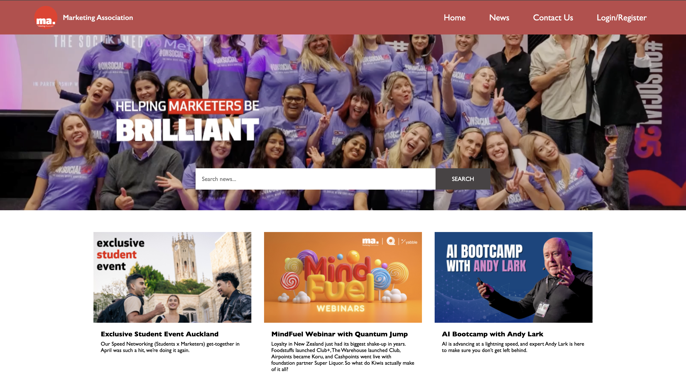
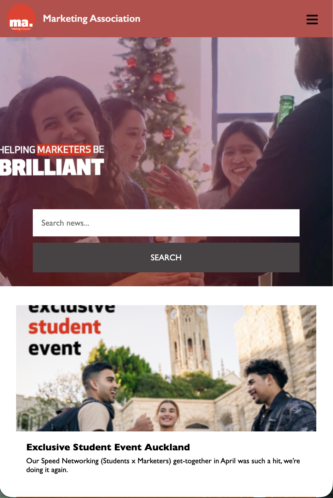

# Marketing Association : Responsive News Page

A responsive news homepage built with React and Vite from a wireframe. The layout adapts from desktop to tablet to mobile, with a hamburger menu on small screens.

## Screenshots

| Desktop                                              | Mobile                                             |
| ---------------------------------------------------- | -------------------------------------------------- |
|  |  |

## Features

- Responsive layout based on the supplied wireframe (3 cards on desktop, 2 on tablet, 1 on mobile)
- Navigation bar that turns into a hamburger menu on phones
- Hero section with a search bar that stacks vertically on mobile
- Reusable `NewsCard` component, with the cards generated from an array of articles
- Scoped styling with CSS Modules

## Tech Stack

- [React](https://react.dev/)
- [Vite](https://vite.dev/)
- CSS Modules

## Getting Started

You need [Node.js](https://nodejs.org/) installed.

```bash
# 1. Clone the repository
git clone https://github.com/nikhilkumar0224/marketing-association-news-page.git

# 2. Go into the project folder
cd marketing-association-news-page

# 3. Install dependencies
npm install

# 4. Start the development server
npm run dev
```

Then open the address shown in the terminal (usually `http://localhost:5173`).

To create a production build: `npm run build`

## Project Structure

```
src/
├── components/
│   ├── Images/       # logo and card images
│   ├── Main/         # hero section, search bar and news grid
│   ├── Navbar/       # header and mobile menu
│   └── NewsCard/     # single reusable news card
├── App.jsx
├── App.css
├── index.css
└── main.jsx
```

## Responsive Breakpoints

| Screen width    | Layout                                   |
| --------------- | ---------------------------------------- |
| Above 900px     | 3 columns, full navigation               |
| 651px to 900px  | 2 columns                                |
| 650px and below | 1 column, hamburger menu, stacked search |

## What I Learned

- How to use CSS Grid and media queries to make a layout responsive
- How to pass data to a reusable component with props
- How to toggle a mobile menu with `useState`

## Future Improvements

- Make the search bar filter the articles
- Load articles from an API instead of a hard-coded array

## Author

**Nikhil Kumar**
[GitHub](https://github.com/nikhilkumar0224) · [LinkedIn](https://www.linkedin.com/in/nikhilkumarnz/)
